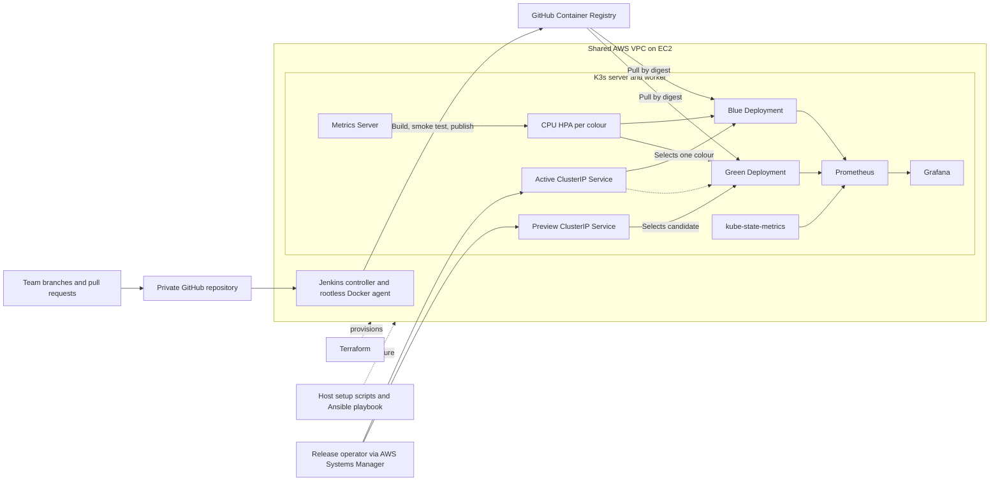

# Development and deployment architecture

Image processing can saturate CPU when uploads spike. The lab demonstrates adding replicas under load and changing the version serving traffic while requests are in flight.

The diagram shows the verified demo starting with blue active and green in preview. Systems Manager provides private access to Jenkins and the cluster Services. The two colours run side by side on the same cluster. The active Service selector determines which one receives application traffic.

| Tool | Reason for use | Advantage | Trade-off |
| --- | --- | --- | --- |
| GitHub | Coordinate changes through branches and PRs | Traceable commits and reviews | Changes to shared files can require conflict resolution |
| AWS VPC, EC2 and Systems Manager | Host the team lab and reach it privately | No public inbound ports are needed for the demo | The team manages access, instances, and running costs |
| Terraform | Define AWS resources and network rules | Reviewable plans and repeatable provisioning | State needs secure storage and coordinated updates |
| Ansible and bootstrap scripts | Configure K3s and the Jenkins hosts | Repeatable host setup | Bootstrap and upgrades need separate verification |
| Jenkins, Docker and GHCR | Build, test, and publish container images | A tested digest can be deployed consistently | The controller, agent, and registry credentials need upkeep |
| K3s and CPU HPA | Schedule containers and adjust replica counts | Kubernetes primitives on a small lab cluster | HPA reacts after CPU rises and is bounded by node capacity |
| Prometheus and Grafana | Observe request rate, latency, and replica count | App and cluster metrics can be viewed together | Scraping and storing metrics consumes resources |
| Blue/green Services | Switch traffic after testing a candidate | Fast rollback while the prior version is ready | Both versions consume capacity during the release |
