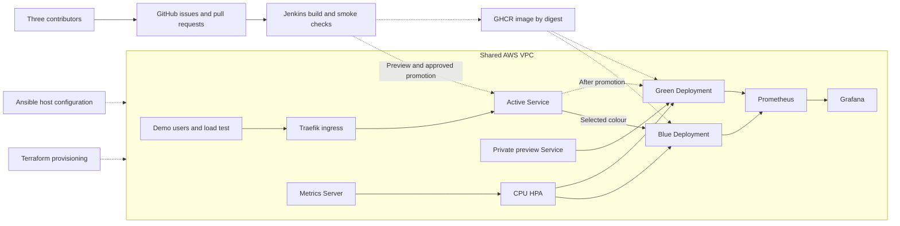

# Development and deployment architecture

The current implementation provides the app, metrics endpoint, Jenkins build and smoke definition, and base Kubernetes manifest. Registry publishing, cloud provisioning, host configuration, and live traffic paths are planned. Both colour deployments are declared in the base. The initial Service selectors route active traffic to blue and preview traffic to green.
